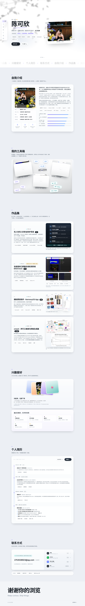

# 陈可欣 · 个人作品集网站

一个可以直接打开使用的单页个人作品集网站，用于**求职 / 实习面试**。
包含：自我介绍、我的工具箱、作品集（4 个项目）、兴趣爱好、个人简历、联系方式，并提供可编辑 Word 简历下载。

动效与视觉参考了 [xiaoyanghu.com](https://xiaoyanghu.com/) 的设计语言：
浅色底、左侧玻璃胶囊导航、大圆角卡片、**吸顶堆叠滚动**、滚动逐段浮现。



## 一、怎么打开

最简方式：**双击 `index.html`**（素材都是相对路径，本地直接可看）。

想更接近线上环境（滚动、字体、简历下载都更准确）：

```powershell
# 在项目根目录执行任意一种
python -m http.server 8123
# 或
npx serve .
```

然后访问 <http://localhost:8123>。

## 二、文件结构

```
personal-website/
├─ index.html                    所有文案都在这里，按 01~05 版块分块
├─ assets/
│  ├─ css/style.css              全部样式与动效（01~10 编号分区）
│  ├─ js/main.js                 全部交互（1~11 编号分区）
│  ├─ resume.docx                可编辑 Word 简历（下载按钮指向它，由 resume-work/build_resume.py 生成）
│  ├─ me.jpg / me-portrait.jpg   首屏方照 / 自我介绍区的竖版照片
│  ├─ photos/trip-1.jpg          兴趣爱好「旅游」展示位的示例照片
│  └─ projects/                  四个项目的配图（见「素材来源」）
├─ preview.png / preview-mobile.png
└─ README.md
```


## 三、素材来源（都是真实素材，可直接替换）

| 文件 | 来源 | 说明 |
| --- | --- | --- |
| `me.jpg` / `me-portrait.jpg` / `photos/trip-1.jpg` | `E:\陈可欣\个人照-cut.jpg` | 同一张照片的三种裁切 |
| `projects/seal-ir-ok.jpg`、`seal-ir-ng.jpg` | 封口检测项目 `output\samples_showcase\` | 真实红外热成像检测输出（OK / NG）；**页面已不再展示**，2026-10-15 已移出仓库（备份在 `E:\烟标检测\algo3\resume-work\_trash_20261015\site-assets\`） |
| `projects/yanbiao-1~6.jpg` | 烟标 App 工程根目录真机截图 | 样本库 / 拍摄检测 / 检测详情 / 结果判定 / 检测历史 / 我的 |
| `projects/seal-ui-realtime.jpg` | 用户提供的软件截图 | 实时检测界面（合格状态）|
| `projects/seal-ui-ng.jpg` | 用户提供的软件截图 | 实时检测界面（不合格状态，含结果日志）|
| `projects/seal-ui-ngview.jpg` | 用户提供的软件截图 | NG 图像回看 / 数据回溯 |
| `projects/seal-ui-config.jpg` | 用户提供的软件截图 | 相机配置与像素标定 |
| `projects/seal-rgb-result.jpg` | 封口项目 `output\samples_showcase\` | 可见光检测结果（封口基准线 + 缺陷标注）；页面已不再引用，2026-10-15 已移出仓库（备份在 `resume-work\_trash_20261015\site-assets\`） |
| `projects/xmesh-dcu-scaling.jpg` | `E:\竞赛\PAC\enhanced_results_figures_20260921\fig5_dcu_scaling.png` | 曙光 DCU 扩展性与加速比曲线 |
| `projects/kit-crop-a.jpg`、`kit-crop-b.jpg` | `E:\yanbiao-detector-kit\output\450956\view.png` | 真实算法输出的缺陷标注图（已裁切放大）；工具包项目卡已撤下，2026-10-15 已移出仓库（备份在 `resume-work\_trash_20261015\site-assets\`） |
| `projects/xmesh-overview/scaling/quality/terrain.png` | `E:\竞赛\PAC\xmesh_total\figures\figures\*.pdf` | 论文配图，由 PDF 转 PNG（200 dpi） |

> 若之后重新跑算法或论文更新了配图，把新图覆盖同名文件即可，版式不用改。

## 四、页面内容与数据出处

页面上的数字都来自项目文档与实验记录，方便你面试时被追问：

| 项目 | 关键数据 | 出处 |
| --- | --- | --- |
| 无人车间人形安全防护系统 | YOLOv8 单类人员检测（conf 0.3 / NMS 0.5）、2–4 路 1280×720 相机、latest-frame + 轮询公平调度 + batch=1、ModelFactory 四类推理后端（PyTorch CUDA/CPU · ONNXRuntime · 算能 Sophon NPU）、ROI ON/IN/OUT + 门区短轨迹方向判定、STARTUP/PERSON/FAULT LOCK 安全状态机、心跳超时强制锁机、端到端验收口径 T0 取帧 → T1 继电器写入 ≤ 200 ms、Modbus RTU + DI 软复位、IO 3 次重试 + 死信队列 | `E:\蓝思科技\people_track_nodi_CPU` 运行时（`system/safety_monitor.py`、`AImodel/RealtimeInferenceScheduler.py`、`track/gate_track/`、`system/e2e_latency_tracker.py`、`io_system/`）与 `people_track_config_V2` 配置工具 |
| 包装袋封口检测 BAGCheck | IR/RGB 双相机同步、OK/NG/UNKNOWN 聚合、IR 量化 7 类指标、MAD 自适应阈值异物检测、动态规划 + RANSAC 封口基准线、配置驱动规则引擎、**NG 图像回看（按状态/时间筛选 + 缺陷浏览/异常统计）**、**逐条结果日志与合格率统计**、证据链与离线回放 | `封口质检系统项目文档.docx`、`项目交接说明.md` |
| 烟标质检助手（HarmonyOS） | 6 类检测方法、黄金集 17 张图、真机单张 11–75 s、自动化验收 6/6、软著受理号 2026R11L1069227 | App 工程 `README.md`、`docs\算法移植路线.md`、`软著签章.pdf` |
| xmesh | 整体 1645.8 s → 1.7 s（约 970×）、`detect_mpi_interfaces` 136.1 s → 0.24 s（569×）、`generate_mesh` 274.0 s → 0.20 s（1362×）、DCU 流水线 3.7–4.5×、雅可比检查最高 12×、64 DCU 弱扩展 4.95 s、I/O 聚合带宽 2161 MB/s、ctest 25/25 | `docs\profiling_2026_06_20.md`、`PDCAT2026_zh_1.md` |
| 烟标检测算法工具包（已并入「烟标质检助手」条目） | 6 个方法、公共底座（Otsu + 保角点 ROI + SIFT 配准）、1 px ≈ 0.0495 mm、最小物理边长 0.5 mm、全量约 35 s / 单张 | `yanbiao-detector-kit\README.md` |

## 五、想改内容改哪里

| 想改什么 | 位置 |
| --- | --- |
| 姓名 / 首屏身份 / 轮播三句话 | `.hero__name`、`.hero__role`、`#rotatorList` |
| 首屏标签、按钮 | `.hero__tags`、`.hero__cta` |
| 首屏照片 | 换掉 `assets/me.jpg`（卡片会自动裁切为 4:3.1） |
| 自我介绍正文 / 技术栈 chips / 技能条 | `.about__body`；技能条改 `data-level="88"` 数值即可 |
| 左侧信息卡（学校、专业、年级、方向、目标岗位） | `.info-list` 的 `<li>` |
| 三个数字（2 / 1 / 1） | `.fact__num` 的 `data-count` |
| **工具箱**（3 个文件夹 + 贴纸） | `#toolbox` 里的 `.toolkit` 是那张大卡片（`aspect-ratio:868/500`，位置全按比例算）；三个文件夹是 `.folder--a / --b / --c`（`left/top/width` + `--rot` 控制摆放与倾斜，`--fx/--fy` 是飞入的起点偏移），口袋里的截图在各自的 `.folder__stack` 里；技术标签是 `.sticker--a1…c3`，只改 `left/top` 和 `--r/--fx/--fy/--dur` 就能挪位置、调漂浮幅度 |
| **四个项目** | `#workStack` 里的 4 个 `<article class="panel panel--project">`，整块复制或删除即可，堆叠动效会自动适配 |
| 项目的配图 | `.project__media` 里的 ``，覆盖 `assets/projects/` 同名文件最省事 |
| 兴趣爱好（5 个展示位） | `.gallery` 里的 `.gphoto`；把 `background-image` 加在 `.gphoto__img` 上就是真照片，`figcaption` 是手写体说明 |
| 「最近在看的、在学的」6 张小卡 | `.hobbies` 里的 `.hobby` |
| 简历时间线 | `.timeline` 里的四个 `.tl`；荣誉列表是 `.honors` |
| 联系方式 | `.contact__links` 的四个 `.link-row`（含 `href`）与 `.copy-bar` 的 `data-copy` |
| 页脚 | `.footer__meta` |

## 六、联系方式与跳转说明

- **邮箱** `2753538923@qq.com`：点击直接唤起邮件客户端（`mailto:`）
- **GitHub**：新窗口打开 <https://github.com/Tang-0118>
- **手机 / 微信** `15319902705`：点击拨号（`tel:`），手机端可直接拨出
- **QQ** `2753538923`：点击打开 QQ 会话窗口
- 下方「一键复制」条：邮箱 / 手机号 / QQ / GitHub 主页，点一下即复制并弹出提示

## 六点五、图片交互（本次新增）

1. **悬停放大**：全站图片（项目配图、真机截图、首屏照片、兴趣爱好照片墙）鼠标移上去都会放大 3%~7%；鼠标指针变为放大镜。
2. **点击弹出大图**：点任意一张图，图片会**从它原来的位置放大飞到屏幕中央**（FLIP 动效），背景高斯模糊。关闭方式：右上角 ✕、按 `Esc`、点背景空白处。
3. **工具箱**：版式与动效照 [xiaoyanghu.com](https://xiaoyanghu.com/) 的 *My Design Toolkit* 复刻——一张大圆角卡片、三个倾斜的文件夹（左上 / 右上 / 正下）、文件夹口里探出一小条截图、跟着文件夹一起歪的说明文字、中间的「CV × HPC」描边大字，技术贴纸全部落在文件夹之间的空位上。

   - **入场**：滚动到视口里，三个文件夹从卡片下方飞到位（左右两个还各自带 ±210px 的横向偏移），用 `cubic-bezier(.16,.84,.24,1)` 1.05s 回弹，卡片 `overflow:hidden` 所以飞行过程收在卡片内。触发逻辑在 `main.js` → 12。
   - **贴纸漂浮**：每张贴纸有自己的振幅、周期和相位（`--fx/--fy/--dur/--d`），用独立的 `translate` 属性做动画，所以旋转和位置互不干扰。
   - **层级**：贴纸 `z-index:2` < 文件夹 `z-index:4`，所以标签永远不会挡住文件夹；贴纸还设了 `pointer-events:none`，点击不会落在它们身上。
   - 口袋里露出多少由 `.folder--x{--peek:15px}` 控制，数字越大露得越多；点一下露出来的截图会弹出大图。
4. **兴趣爱好照片墙**：五张照片像摊在桌上的相片一样互相叠压（`.gallery` / `.gphoto`），**鼠标移上去那张自动放大展开、压到最上层**，也能拖着换位置、点开看大图。移动端改成横向滑动浏览。
5. 原图较小时，弹窗会自动最多放大 2.2 倍显示，不会出现「弹出来还是一张小图」。手机端点击同样可用。

> 如果某张图不想被点击放大，给它加 `data-no-zoom`（或在 `main.js` 的 `ZOOM_SEL` 里排除该容器即可）。

## 七、动效一览

| 效果 | 实现位置 |
| --- | --- |
| 首屏文字逐行「遮罩上移」入场 | `.mask` / `.mask__in` + `main.js` 首屏入场 |
| 姓名手写下划线「画出来」 | `.squiggle path` 的 `stroke-dashoffset` 动画 |
| 首屏三句话自动轮播 | `main.js` → 3 |
| 左侧胶囊导航：当前版块高亮 + 展开文字（移动端变底部导航） | `main.js` → 4 |
| **作品集卡片吸顶堆叠**（上一张缩小压暗，下一张盖上来） | `main.js` → 5（rAF 逐帧计算） |
| 项目配图轻微视差、手机截图错落悬浮 | `main.js` → 6 + CSS |
| 滚动进度条 | `.progress` + `main.js` → 11 |
| 数字滚动增长、技能条伸展 | `main.js` → 7 |
| 兴趣爱好照片墙可拖拽 | `main.js` → 8（Pointer Events） |
| **工具箱文件夹飞入**（左右两个从卡片外下方旋着飞进来）+ **贴纸缓慢漂浮**（每张贴纸振幅/周期不同） | `.toolkit.is-in .folder` 的 `transform` 过渡 + `main.js` → 12（IntersectionObserver）、`@keyframes stickerFloat` |
| **鼠标悬停放大**（图片放大 + 轻微扶正 + 阴影加深） | `.tb-shot:hover`、`.media--thermal .thermal:hover img` 等（08.7 区） |
| **点击弹出大图**（灯箱，从缩略图位置 FLIP 放大，Esc / 点空白关闭） | `main.js` → 12 + `.lightbox` 样式（08.8 区） |
| 复制反馈（绿色高亮 + 底部提示条） | `main.js` → 9 |
| 鼠标跟随柔光 + 页面光斑漂移 | `.glow` / `.texture` |
| 流动文字带（悬停暂停） | `.marquee` |

**无障碍**：所有动效都尊重系统的「减弱动态效果」设置（`prefers-reduced-motion`），开启后自动关闭位移与视差。

## 八、部署

纯静态文件，任意静态托管都能直接用：

- **GitHub Pages**：整个文件夹推到仓库 → Settings → Pages → 选分支根目录
- **Vercel / Netlify**：直接拖拽文件夹上传，无需构建命令

## 九、待确认 / 可继续完善

1. **学院名称**：页面按《学年鉴定表》写的「计算机学院」，如已并入其它学院请告知
2. **项目时间**：目前用「2026 — 至今」这类年粒度表述，可补充到月份
3. **专利名称与申请号**：页面只写了「专利在审」，可补充具体名称
4. **论文状态**：PD-CAT 2026 显示「在审」，录用后可改为「已录用 / 已发表」
5. **图片瘦身**：`assets/projects/xmesh-*.png` 体积较大，若部署到免费静态托管可再压一次（未使用的 `kit-crop-*.jpg`、`kit-scan.jpg`、`xmesh-quality.png`、`yanbiao-2.jpg`、`seal-ir-*.jpg` 已于 2026-10-15 移出仓库，见 `resume-work\_trash_20261015\`）
6. **简历 Word 同步**：`assets/resume.docx` / `assets/resume.pdf` 由 `E:\烟标检测\algo3\resume-work\build_resume.py` 生成（再用 Word 导出 PDF）。更新网页内容时记得同步重跑，保持网页与简历一致。
7. **兴趣爱好照片**：目前除「旅游」外都是渐变占位图，换成自己的照片后记得删掉那句「占位图」提示（`.interest__hint`）
8. **安全防护系统的配图**：`E:\蓝思科技` 里没有界面/现场截图，所以那张卡用的是 CSS 画的「取帧 → 推理 → 判定 → 锁机」链路图（`.media--flow`）；若有实时画面或配置工具截图，替换成真图会更有说服力。
9. **两张预览图**：`preview.png` / `preview-mobile.png` 由 `resume-work\shot_cdp.cjs` 重新生成（`node shot_cdp.cjs <url> <out.png> <宽> <高> full`，注意用 1440 宽截图再缩到 720，页面最小内容宽度约 876 px）。
